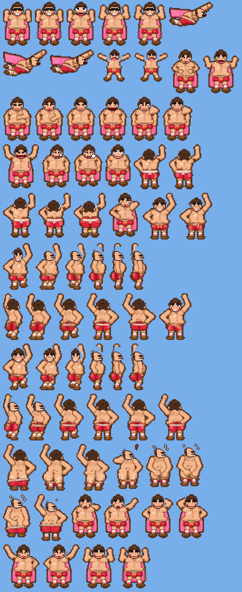

# MANDEX

An Angry Birds-style game: a sticky dad-bod man in red underwear and a pink towel-cape gets flung into voxel buildings and
wrecks them with sandbox-style destruction physics, to evict the landlords inside.  Tasteful, silly, and a tad explicit.



One game, four builds: a browser version with its own JS physics, and three consoles sharing one C core:

| Port | Where | State |
| --- | --- | --- |
| Browser | `web/index.html` (single file, open it in any browser) | playable, has its own JS physics |
| Nintendo DS | `ds/` (bare-metal ARM9/ARM7, fixed point) | CI builds NDS ROMs and runs DeSmuME smoke/FPS probes; physical-device performance and cartridge save support remain unverified |
| Nintendo 3DS | `3ds/` (devkitARM + libctru, float, software rendering) | CI builds 3DSX with sprite art and NDSP synthesis; new SD journaling needs console/emulator validation |
| Sega Dreamcast | `dreamcast/` (KallistiOS, float) | CI builds experimental CDI and ELF with audio; new VMU journaling needs emulator/hardware verification |

`core/mx.c` is the shared C game core for the three consoles (a 120x60 voxel grid, rigid chunks, a wobble lattice with
8 block kinds and 60 levels (20 story levels, 20 chapter 2 levels, then 20 chapter 3 levels; same layouts and mechanics as the web game); `core/mx_meta.c` holds the stars, achievements and outfits rules), `art/` holds the generated pixel art and the idle-gag player, `tools/` the sprite generator,
`test/` the host tests.  See [PORTING.md](PORTING.md) for the full status, design notes and what is not verified.

See [November 20 cross-port development waves](docs/IMPROVEMENT_WAVES_2026-11-20.md)
for the current performance-sensitive improvements and the major features still
outstanding.  Passing CI/host tests does not imply 30 FPS on original hardware.

## Further gameplay and frame-cost pass

- **Collapse aftermath:** rare HP- and structure-dependent survivors now
  require actual supporting floor, lose armor, recover from stun and flee
  briefly. Each survivor has a persistent gold indicator in the browser,
  DS, 3DS and Dreamcast scenes. Destructible rubble that is already dead
  never deals invisible damage.
- **Fixed-point collision integrity:** an early conservative ±256-cell
  distance guard prevents enormous debris separations from overflowing
  the 20.12 squared-distance contact test. This deliberately corrects a
  pathological ghost-hit case; the safety guard is enabled with *both*
  reference and optimized builds, so speed parity does not depend on
  preserving incorrect hits.
- **Per-fragment contact optimization:** moving-rubble collisions use a
  cheap axis-aligned gate before the exact circular distance test. The
  browser checks the same geometry. Two focused regressions include
  **200,000 contact positions per C numeric mode** plus **8,281 actual
  browser collision cases**; tests cover contact edges, destroyed rubble,
  stun/kill thresholds and remote overflow ghosts.
- **Measured isolated host cost:** the
  [rubble A/B gate](https://github.com/masong0508-lab/mandex/actions/runs/44863019245)
  verified complete-world state parity on all 60 levels (360 scripted
  frames each). For the rubble rectangle alone, fixed-point host CPU
  changed **429.90 → 429.00 ms** (0.21% faster) and floating-point
  changed **322.70 → 320.20 ms** (0.77% faster) in that run.
  This is *not* console FPS. Tiny gains can vary with host load.
- **3DS stereo rendering:** culls fully offscreen flying voxel tiles
  before per-pixel drawing; the host stereo-framebuffer A/B probe now
  includes real moving rubble at viewport edges and multiple brightness
  values. Standing voxels, visible rubble, and damage tints remain on
  their original drawing paths.
- **Dreamcast:** rotated rubble polygons whose conservative 4px
  envelope misses the 640×480 display are not submitted to the PVR.
  A host software-PVR comparison renders the actual textured,
  rotated tile primitive with edge-crossing and offscreen positions.
  No new textures, large buffers, or gameplay-speed changes are required.

## November 21 continuation — verified AI distance optimization

- The native core now avoids fixed-point square roots for landlords farther
  than the **36-cell interaction envelope**, while using the original
  distance result for every nearby attack, chase, and panic threshold.
  Browser/Android AI already uses squared-distance comparisons and now also
  fixes a stale variable in the bat-flight reaction that could crash play.
- [Simulation/render A/B workflow](https://github.com/masong0508-lab/mandex/actions/runs/44861837277)
  checked **all 60 levels × 360 scripted frames** for exact complete-world
  parity in both floating and fixed physics. Its *combined* optimization
  measurements were **1.65% lower host fixed-point simulation CPU time**
  and **0.61% lower host floating-point simulation CPU time**. These are
  combined fast-path results, not isolated AI savings, and do not
  establish DS/3DS/Dreamcast hardware FPS.
- Wounded survivors now require a grounded escape pocket, briefly flee
  using existing physics, and remain visibly marked in every port.
  Destroyed rubble cannot collide with landlords.

## Rare collapse survivors — all ports

Landlords can now *occasionally* emerge alive from a near-total building
collapse. This is evaluated only on an otherwise lethal fall, burial or
moving-rubble impact, never by doing extra room scans every frame.

- A landlord must belong to a room whose original roof, floor and structural
  posts have lost **at least 60%** of their support, and a nearby empty body
  pocket with **real supporting floor beneath it** must exist. No floating,
  outdoor or intact-building miracles.
- The probability is deliberately small: about **1–3.5% for a one-HP enemy**
  and up to approximately **7% for a three-HP boss**, depending on how much of
  the room survives. More current HP and a few more standing supports
  increase the chance; being utterly crushed with no escape space prevents it.
- A survivor loses one HP if it has more than one, drops armor, and becomes
  briefly stunned and impact-protected. It gets **one attempt per landlord**,
  success or failure, and normal hazards resume after the short recovery.
  Once recovered, even normally stationary enemies attempt a short retreat
  away from the fallen room using the real wall/floor collision rules. Direct
  shots and subsequent hits can still evict them. A small persistent gold
  marker identifies survivors after the *SOMEHOW ALIVE!* / *STILL ALIVE!*
  message and reused dust effects fade.
- The destruction solver remains shared by Nintendo DS, Nintendo 3DS and
  Dreamcast; browser uses corresponding JS rules. Survivor identity uses a
  few small world-state fields, with **no new textures, framebuffers, heap
  allocations or per-frame room-support scans**.
- `test/collapse_survivor_test.c` and
  `test/collapse_survivor_web_test.js` cover surviving room geometry,
  supported rescue pockets, stunned recovery, reduced HP, one-time rolls,
  and continued killability. `test/landlord_ai_web_test.js` executes the
  actual bat AI (fixing a formerly undefined-distance crash) and checks
  post-collapse retreat.

## Bank Shot trick scoring + another measured speed pass

- **New gameplay challenge (all four ports):** rebound off a rubber block,
  then directly evict a landlord with the flying man within **2 seconds**.
  The first qualifying hit awards **+1,500 BANK SHOT** in addition to existing
  combo points. TNT, falling rubble, remote explosions and walking collisions
  cannot earn it. One rubber rebound can award the bonus only once. The browser
  teaches it in *Rubber Room* and shows a score callout; the DS, 3DS and
  Dreamcast display their own feedback, reusing existing text effects.
- **DS rendering:** empty four-cell masonry runs are skipped and damage-color
  thresholds are precalculated per material. The shared DS/3DS/Dreamcast
  ellipse rasterizer reuses symmetrical integer-square-root work. All
  optimizations preserve the sprite assets, pixel dimensions and simulation
  steps; no extra framebuffer or heap allocation was added.
- **Browser performance:** the frequently executed airborne man-to-landlord
  collision uses squared distances rather than a square root. It retains the
  same gameplay radius. These CPU savings are not a whole-game FPS claim.
- **Validated earlier speed pass:** the dedicated
  [simulation/render A-B workflow](https://github.com/masong0508-lab/mandex/actions/runs/44857948640)
  reported **+1.14% fixed simulation, +0.28% floating simulation** on the
  test host, and **3.67–7.66% lower DS host CPU frame time** on four sampled
  levels. The comparisons had matching complete world digests and matching
  frame hashes. These are NOT original console FPS figures.
- **Regression gates:** `test/bank_shot_test.c` exercises armored targets,
  expiring bonuses, repeat awards and real rubber bounce in float and fixed
  modes. `test/run_tests.sh` and the focused feature workflow run it along
  with the existing gameplay/cutscene/graphics tests. Build and hardware
  validation for subsequent gameplay changes are separate from the earlier
  measured speed pass.

## November 20 continuation: cross-port gameplay + speed

This pass is integrated on **main** (no parallel feature branches):

- **Smarter, event-driven landlord reactions:** structural cracks, heavy
  rubble and explosions can make nearby enemies panic and attempt to escape.
  The shared C core and JavaScript gameplay both react only when a hazard
  occurs; the C path has a compile-time reference switch.
- **Safe progress on additional hardware:** 3DS stores two CRC-checked
  alternating files at `sdmc:/3ds/mandex/`; Dreamcast uses two VMU A1
  sectors. Both preserve existing star, outfit, achievement and score
  formats. A simulated interrupted-VMU-write regression test covers
  recovery after a partial replacement. Cartridge/VMU/SD hardware
  verification is still required.
- **3DS renderer:** integer circle rasterization replaces repeated
  per-column square roots, including both stereoscopic eyes. Host
  framebuffer hashes are compared to the exact old primitive.
- **Pixel-identical particle-pool acceleration:** DS, 3DS and Dreamcast
  remember the lowest free particle slot, reducing repeated searches
  during large demolition effects. Cracking and settling buildings also
  receive small, bounded dust bursts.
- **Browser Eco FX:** **F4** switches between full decorative particles
  and a tighter 360-particle visual budget; F3 displays FPS, simulation
  rate and the chosen effects setting. The switch affects effects only,
  not AI or destruction simulation.
- **Sound and memory:** a formerly silent heavy-rubble event is fixed
  across console ports; 3DS and Dreamcast audio startup avoids
  duplicate PCM storage.
- **CI throughput:** superseded long-running builds and performance
  audits are canceled so current `main` receives the resources. Focused
  smoke tests cover crashed saves and four DS levels, while the longer
  pixel/physics suites cover wider regressions.

**Measurement caution:** host CPU timings and parity checks do not prove
30 FPS on hardware. Test with the on-device frame meters and confirm
sound, SD/VMU saving and controller behavior on the target systems.

## What is in it

- **Destruction physics**: voxel buildings sit on springs (they sway, crack, snap and topple); wood, brick, stone, glass,
  TNT, steel, rubber and sand all behave differently.  Rubber boings the man back.
- **The man**: 54 pixel-art poses.  Idle gags (belly slap, butt wiggle, belly scratch, burp, fart, nose pick, yawn, and
  a cape taunt where he steps round on his feet, whips off his cape and flags a real cloth towel while he wags his butt), gross-out effects (stink clouds, flies,
  boogers, sweat), a sleep with snot bubble after 20 s, a victory butt-wiggle dance and a sad slump on defeat.
- **The towel** is a small cloth simulation (`core/cloth.c`, recipe in `docs/CLOTH.md`): it flutters, folds and turns edge-on
  with his body, the same in the browser, on the DS and on the Dreamcast.
- **Progress**: 1-3 stars per level, 25 achievements, outfits.  The browser uses local storage; the DS has cartridge-save code (hardware unverified), the 3DS has dual-slot SD saves and Dreamcast has experimental dual-slot VMU saves.  The DS has an
  achievements list with progress bars and an outfits screen (swatches, padlocks, how to unlock).  Level locks (first 3 open, then in
  order) are built but switched off (`-DMX_LEVEL_LOCKS`) until saving exists; on the DS title L+R+SELECT is the unlock-all cheat.
- **Options** (browser): a simple OPTIONS screen from the main menu.  *Collapsible buildings* keeps fallen rubble physical (it keeps slumping and
  toppling) until the level ends; off, rubble settles and locks solid.  Either way, damaged walls crumble after each run.
- **Body jiggle**: his belly and rear are damped springs, kicked while he flies, hits something or drops, plus an
  impact squash.  It is cosmetic and never touches the physics.
- **Eviction combos**: chain landlord defeats within 2.5 real-time seconds for a capped +1,000/+2,000/+3,000/+4,000 score bonus and increasingly outrageous adult-comedy stingers. The browser and three consoles share the same score rules; it never affects saved-file structure or adds an allocation.
- **Comparable runtime diagnostic overlays across all four ports**: DS **L**: ARM7 VBlank-observed render FPS, simulation steps per second and top/bottom/DMA timing; 3DS **L+R**: observed FPS/SPS from libctru time; Dreamcast **both analog triggers**: observed FPS/SPS from KOS time; browser **F3**: requestAnimationFrame FPS, actual gameplay update calls/s, and percentage of real time advanced by the clamped game timestep. The overlays operate only while enabled/held and do not claim that host microbenchmarks equal hardware FPS.
- **DS real-time simulation recovery**: on the bare-metal ROM, the ARM7 VBlank counter reveals when drawing consumed two or three video periods. Rather than silently slowing the game to 30 simulation steps/s, the ARM9 can now execute 2-3 **actual 1/60-second physics steps** in a frame if its measured previous physics cost is low enough. Each step's collision/explosion/meta events are processed immediately (never overwritten by a later step), and stalls of more than four VBlanks or expensive physics updates do not trigger a catch-up storm. The L debug meter reports observed simulation SPS and rendered FPS independently. Host regression validates the bounded decision policy.
- **Wobble candidate-propagation experiment (disabled)**: the complete 60-level game world was byte-identical in fixed+float runs, but benchmark outcomes were mixed (roughly -3% to +2% vs the original scan). Default `MX_WOB_HOT_PROPAGATE=0` keeps the measured-stable algorithm. The optional flag remains for further profiling and reuses existing scratch arrays without allocating memory.
- **Wobble lean coefficient reuse**: the spring solver’s vertical lean coefficient depends only on fixed row height and constant stiffness, not on time, level or movement. It now initializes the existing `wob_lean[MX_ROWS]` array once and reuses the exact same values instead of recalculating 59 fixed/float multiplications on every active frame. Gameplay CI compares the old and new implementations over all 60 levels and 360 frames/level, including byte-for-byte world-state digests in both numeric modes; disabling flag `MX_WOB_PRECOMPUTE_LEAN=0` restores prior behavior.
- **Wobble subphase profiling**: the host DS audit separates scanning, spring substeps and joint checks. Experimental per-tick damping caching matched gameplay checksums but produced mixed/slower host results (especially float), so it defaults off (`MX_WOB_CACHE_DAMP=0`).
- **Repeatable wobble CPU comparisons**: CI now runs four pairs of old-versus-new spring solver tests per numeric mode, alternating the execution order to expose shared-runner timing noise. The median over 60 levels × 360 frames is reported alongside every raw timing and verified outcome checksum; host microbenchmarks remain separate from DeSmuME and real hardware readings.
- **Physics wobble four-neighbor A/B**: `MX_WOB_UNROLL_NB` (default 1) explicitly calculates four alive-neighbor spring forces in the same order as the former inner loop, avoiding per-voxel loop control without changing the maths. The gameplay profiler compiles old and new versions for both fixed and floating point, verifies their 60-level state outcomes match at both 120 and 360 frames/level, and records host timing gains or regressions.
- **DS simulation inner-loop profiling**: the DS audit compiles a host-only build of the real `mx_update()` with seven separate timing spans—player/explosions, structural support, chunk physics, wobble, sand, enemy AI, and poses/outcomes. Results are per-stage host CPU microseconds, never claimed as ARM9 FPS. Production ROMs compile these probes out entirely.
- **DS landlord visibility culling experiment**: screen-bounds culling rendered pixel-identical artwork, but was slightly slower or neutral in most host scenarios, so it defaults **off** (`MX_DS_CULL_TARGETS=0`). Retains an optional A/B flag for hardware profiling; simulation and AI remain untouched in both paths.
- **Wallpaper batching trial**: contiguous wallpaper runs were pixel-identical, but 1–8% slower in eight host scenarios; `MX_DS_WALL_RUNS` therefore defaults to **off**. Do not mistake this tested experiment for an optimization.
- **Tiny opaque tile performance path**: frequent 2×2 and 4×4 pixel tiles on both DS screens now bypass the generic inner loop. A separate audit compares 51,200 random damage/wall draw calls between old and new builds and checks pixel hashes and buffer guards; `-DMX_DS_FAST_TILES=0` disables it for A/B measurement. The appearance and memory budget are unchanged.
- **DS emulator FPS comparison**: the [test-only DeSmuME probe workflow](.github/workflows/ds-emulator-fps.yml) now builds otherwise identical `reference` (`MX_WOB_UNROLL_NB=0`) and `optimized` (`=1`) ROMs for levels 1, 40, and 60; both run the default 30 Hz lower-screen policy and capture the ARM7-clock FPS/SPS overlay after identical scripted shots. These are emulator observations, never proof of actual physical hardware speed.
- **Experimental 15 Hz bottom-screen overload mode (disabled by default)**: controlled DeSmuME snapshots were mixed—Suburban Eviction 53→56 rendered FPS, Landlord HQ 27→25 (regressed), Alpha Landlord 28→38, with different physics states between samples. Keep reliable 30 Hz idle lower-screen redraw as the default; developers may opt into `-DMX_DS_OVERLOAD_BOTTOM15=1` for further A/B experiments. Both versions preserve full-rate lower-screen refresh while touch or D-pad aiming is active. The [emulator FPS workflow](.github/workflows/ds-emulator-fps.yml) explicitly builds both variants. Emulator frame rates do not demonstrate hardware performance.
- **DS second-screen rate reduction with A/B timing**: both DS software-rendered screens previously refreshed every game frame. The top stays full-rate, but the lower overview/aim display now refreshes at 30 Hz when untouched; stylus dragging and D-pad aiming immediately restore full-rate bottom drawing. Skipped lower-screen frames also skip their VRAM DMA transfer. CI compiles the old 60 Hz bottom path and the new 30 Hz path in the same run, publishing paired *host CPU cost* measurements by level. This does not promise 60 rendered DS FPS on physical hardware.
- **Measure real DS FPS rather than assume 60**: on a bare-metal ROM, press **L** to see actual rendered FPS and simulation steps/s (ARM7 VBlank clock), missed VBlanks and phase timing (ARM9 timer). The new [DS bottleneck audit](.github/workflows/ds-fps-audit.yml) profiles real game-loop CPU cost in eight representative levels split by input, physics, event processing, top draw, bottom draw and VBlank/DMA; host microseconds are **not** hardware FPS. Adaptive quality no longer copies the bottom bitmap into VRAM when its redraw is skipped.
- **3DS gameplay night/parity + deterministic level profiling**: Chapter 3 now uses a proper moonlit blue-purple sky, nighttime clouds, city lights, and darker layered hills/trees instead of reusing the daytime palette. Forty-one snowy ridgeline samples are computed just once for both stereo eyes instead of recalculating trigonometry every frame. A dedicated [gameplay profiling workflow](.github/workflows/gameplay-perf.yml) measures every level for 120 deterministic physics frames in fixed and float modes; these are host measurements, not console FPS.
- **Measured cutscene performance**: the shared 8-bit renderer fast-fills full-width bands and entire frames as single memory operations, with 480 reference-rectangle checks added to the pixel-equivalence suite (1,920 shapes total). Every fast cutscene CI run reports measured host-only mean/p50/p95/max rendering times by story mode plus an artwork checksum in an attached text artifact. These results are not hardware FPS measurements.
- **Cinematic acting and sound parity**: DS/3DS/Dreamcast now share rooted gestures, one-eyed winks, recoil and nod animation, lightweight parallax city lights, detailed indoor garage artwork and corrected first-frame sound cues, with an audio regression assertion. The web build gets equivalent lamplit skyline art and single-eye winks. Browser romantic lighting is bounded to its actual glow area.
- **Visual cutscene contact sheets**: the [Cutscene gates](.github/workflows/cutscene-gates.yml) Actions workflow runs fast browser and console checks, renders a representative three-frame storyboard from six major story beats, converts the sheets to PNG with only Python's standard library, and uploads the PNGs as a `mandex-cutscene-storyboards` artifact for visual review. These previews are not new in-game textures and consume no runtime memory.
- **Cartoon rear-view slapstick**: Enlarged rear-view comedy panels, elastic fabric/fur wobble, tail and costume acting, harmless rubber suction-cup misfires, laugh captions, and timed boing cues in origin, wolfman, and chapter-complete cutscenes across the browser and DS/3DS/Dreamcast. No sexual penetration, additional console assets, framebuffers, or heap allocations.
- **Adult-comedy romance cutscenes**: Gerald and Brenda share exaggerated winks, glamorous fully clothed designs, over-the-top flirtation, a briefly silhouetted kiss, and a moonlit fade-to-black. Browser effects are rendered directly on the existing canvas; console cutscenes use the shared low-memory 8-bit renderer. The content is suggestive, not graphic sexual depiction. The intended adult tone is not an official age rating.
- **Illustrated cutscene artwork pass**: 15 compact hand-designed pixel-art emblems, shingled homes and detailed props, layered starry skylines and moon craters, story-specific rain, paper scraps, sparks, confetti and slow atmospheric motion. The DS/3DS/Dreamcast share an 8-bit storyboard renderer; the browser displays matching emblems, sliding illustrated scene cards, beat-specific ink swishes and impact captions. No extra handheld framebuffers, atlases or heap allocations.
- **Cinematic cutscene pass**: eased camera pushes, comic impact accents and dialogue progress on the browser; lightweight atmosphere, shot-decay camera shake, and narration progress cues in the DS/3DS shared intro.
- **Handheld visual-parity pass**: DS and 3DS dress destructible room backdrops with multi-pane windows, curtains, furniture, surviving-roof highlights and street signage. The 3DS gains a title poster and demolition meter. Its 3px and 4px tile atlases stay cached separately, so changing screens no longer rebuilds materials each frame (about 35 KB extra static RAM, no heap).
- **Handheld performance pass**: bare-metal DS uses DMA3 instead of thousands of CPU writes when copying both 8-bit framebuffers to VRAM. The audio sequencer catches up to ARM7's independent VBlank count if the ARM9 game frame is delayed, keeping tempo close to real time. Under rendering pressure the DS reduces decorative bottom-screen updates while preserving full-rate stylus dragging. 3DS culls offscreen world voxels/wallpaper and uses a one-time 6 KB hill-height lookup instead of per-frame trigonometry; stereo camera smoothing updates just once per frame.

## Build and test

```sh
sh test/run_tests.sh            # host tests: needs only gcc (a few minutes: includes a 560-run robustness sweep)

cd ds && make                   # -> mandex.nds   (needs devkitPro: devkitARM + libnds)
cd dreamcast && make            # -> mandex.elf   (needs KallistiOS: source its environ.sh first)

pip install numpy pillow playwright && python -m playwright install chromium
python tools/gen_manspr.py      # re-render art/manspr.h from web/index.html's own drawing code
```

Controls: DS stylus drag-and-release to fling, tap in flight to belly-flop; 3DS the same on the bottom screen; Dreamcast analog stick to pull, A to launch
or flop.  Chapter 2 walk levels (Walk-Up Wreckage, Collection Day, Batter Up): once he lands on his feet, DS/3DS d-pad
walks, A / up jumps, B / Y punches, X / down belly-slams, L gives up (3DS also has touch buttons); Dreamcast d-pad or stick walks, A jumps, B punches, X slams,
L trigger gives up.  Landlords fighting back can be switched off: DS options screen, 3DS Y on the title, Dreamcast Y on the title (X on the pause screen).
Full list in [PORTING.md](PORTING.md).

## Workflows (`.github/workflows`)

| Workflow | When | What |
| --- | --- | --- |
| `tests.yml` | push, PR | runs `test/run_tests.sh` |
| `build-ds.yml` | push / PR touching `ds`, `core`, `art` | builds `mandex.nds` in the `devkitpro/devkitarm` image, uploads it |
| `build-dreamcast.yml` | push touching `dreamcast`, `core`, `art`, or manual | **experimental**: builds `mandex.elf` in a community KallistiOS image, allowed to fail |
| `sprites.yml` | manual | re-renders the sprites from the browser version and uploads `art/manspr.h` |
| `pages.yml` | manual | publishes `web/` to GitHub Pages |
| `release.yml` | tag `v*` | tests, builds the DS ROM, attaches the ROM and `mandex.html` to a release |

GitHub Actions has produced DS, 3DS homebrew, and experimental Dreamcast
images. The combined ROM workflow packages the standalone browser HTML
alongside the three console platforms. Build success is not the same as
on-device verification.

## Honest status

Console builds run in GitHub Actions; host rendering, save corruption,
fixed/float physics and DeSmuME FPS smoke tests provide additional checks.
The DS and 3DS synthesize audio, and Dreamcast routes music/effects to
AICA. Actual device-level performance, save reliability and audio quality
remain unverified. A build or host test succeeding does not establish
console hardware FPS.

DS character sprite clipping A/B instrumentation (`MX_DS_FAST_MAN`).
