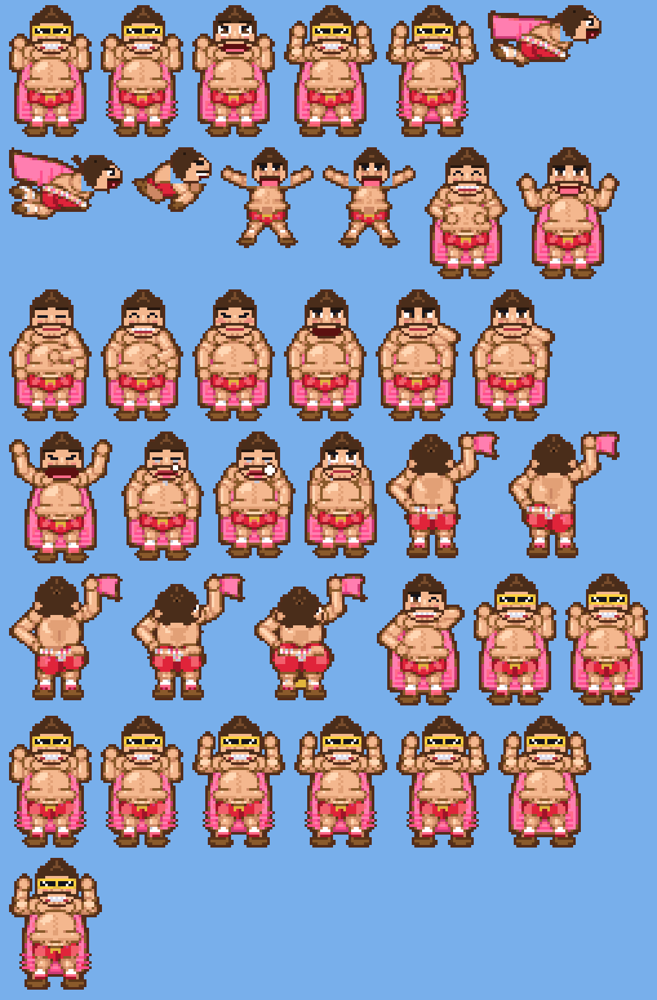

# MANDEX

An Angry Birds-style game: a sticky dad-bod man in red underwear and a pink towel-cape gets flung into voxel buildings and
wrecks them with sandbox-style destruction physics, to evict the landlords inside.  Tasteful, silly, and a tad explicit.



One game, four builds: a browser version with its own JS physics, and three consoles sharing one C core:

| Port | Where | State |
| --- | --- | --- |
| Browser | `web/index.html` (single file, open it in any browser) | playable, has its own JS physics |
| Nintendo DS | `ds/` (devkitPro / libnds, 20.12 fixed point) | written and tested on the host with stub libnds, **never built or run on a real DS or emulator** |
| Nintendo 3DS | `3ds/` (devkitARM + libctru, float, software-drawn) | furthest behind: circles-and-rectangles man, no sound; **never built or run on a 3DS or emulator** |
| Sega Dreamcast | `dreamcast/` (KallistiOS, float) | same: host-tested with a software rasteriser, **never built for real** |

`core/mx.c` is the shared C game core for the three consoles (a 120x60 voxel grid, rigid chunks, a wobble lattice with
8 block kinds and 34 levels (20 story levels, then 14 chapter 2 levels; same layouts as the web game); `core/mx_meta.c` holds the stars, achievements and outfits rules), `art/` holds the generated pixel art and the idle-gag player, `tools/` the sprite generator,
`test/` the host tests.  See [PORTING.md](PORTING.md) for the full status, design notes and what is not verified.

## What is in it

- **Destruction physics**: voxel buildings sit on springs (they sway, crack, snap and topple); wood, brick, stone, glass,
  TNT, steel, rubber and sand all behave differently.  Rubber boings the man back.
- **The man**: 54 pixel-art poses.  Idle gags (belly slap, butt wiggle, belly scratch, burp, fart, nose pick, yawn, and
  a cape taunt where he steps round on his feet, whips off his cape and flags a real cloth towel while he wags his butt), gross-out effects (stink clouds, flies,
  boogers, sweat), a sleep with snot bubble after 20 s, a victory butt-wiggle dance and a sad slump on defeat.
- **The towel** is a small cloth simulation (`core/cloth.c`, recipe in `docs/CLOTH.md`): it flutters, folds and turns edge-on
  with his body, the same in the browser, on the DS and on the Dreamcast.
- **Progress** (all consoles, this session only until save data lands): 1-3 stars per level, 25 achievements, outfits.  The DS has an
  achievements list with progress bars and an outfits screen (swatches, padlocks, how to unlock).  Level locks (first 3 open, then in
  order) are built but switched off (`-DMX_LEVEL_LOCKS`) until saving exists; on the DS title L+R+SELECT is the unlock-all cheat.
- **Options** (browser): a simple OPTIONS screen from the main menu.  *Collapsible buildings* keeps fallen rubble physical (it keeps slumping and
  toppling) until the level ends; off, rubble settles and locks solid.  Either way, damaged walls crumble after each run.
- **Body jiggle**: his belly and rear are damped springs, kicked while he flies, hits something or drops, plus an
  impact squash.  It is cosmetic and never touches the physics.

## Build and test

```sh
sh test/run_tests.sh            # host tests: needs only gcc (a few minutes: includes a 560-run robustness sweep)

cd ds && make                   # -> mandex.nds   (needs devkitPro: devkitARM + libnds)
cd dreamcast && make            # -> mandex.elf   (needs KallistiOS: source its environ.sh first)

pip install numpy pillow playwright && python -m playwright install chromium
python tools/gen_manspr.py      # re-render art/manspr.h from web/index.html's own drawing code
```

Controls: DS stylus drag-and-release to fling, tap in flight to belly-flop; 3DS the same on the bottom screen; Dreamcast analog stick to pull, A to launch
or flop.  Full list in [PORTING.md](PORTING.md).

## Workflows (`.github/workflows`)

| Workflow | When | What |
| --- | --- | --- |
| `tests.yml` | push, PR | runs `test/run_tests.sh` |
| `build-ds.yml` | push / PR touching `ds`, `core`, `art` | builds `mandex.nds` in the `devkitpro/devkitarm` image, uploads it |
| `build-dreamcast.yml` | push touching `dreamcast`, `core`, `art`, or manual | **experimental**: builds `mandex.elf` in a community KallistiOS image, allowed to fail |
| `sprites.yml` | manual | re-renders the sprites from the browser version and uploads `art/manspr.h` |
| `pages.yml` | manual | publishes `web/` to GitHub Pages |
| `release.yml` | tag `v*` | tests, builds the DS ROM, attaches the ROM and `mandex.html` to a release |

The DS and Dreamcast build workflows are the first real test of those Makefiles: expect to fix a few compile or link
problems on the first runs.

## Honest status

Everything compiles and passes on a normal PC compiler, but the console builds were written without a toolchain, no
emulator or hardware has run them, DS frame time is unknown (the in-game profiler is on `L`), and none of the sounds
have been heard.  The Dreamcast port has no sound yet.
